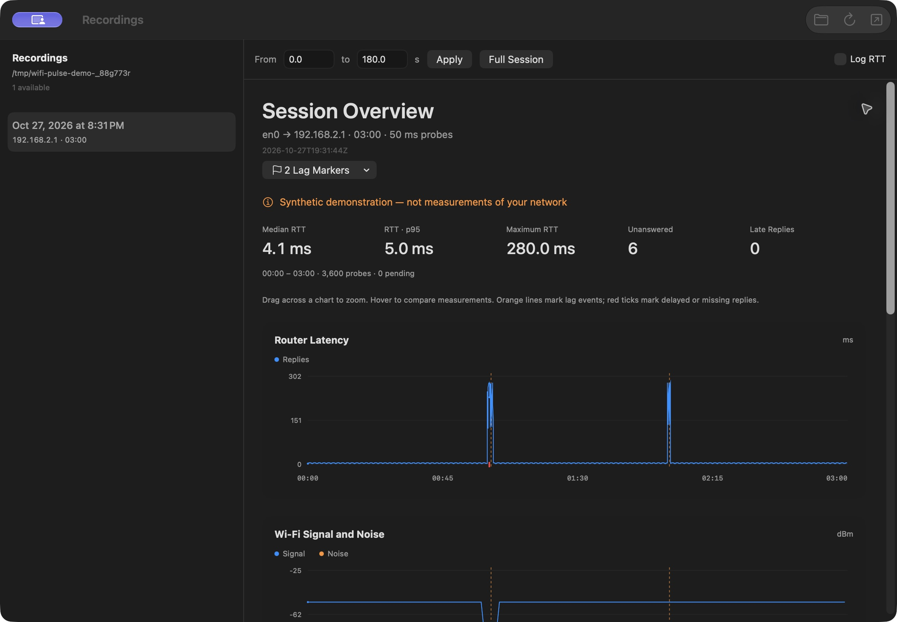
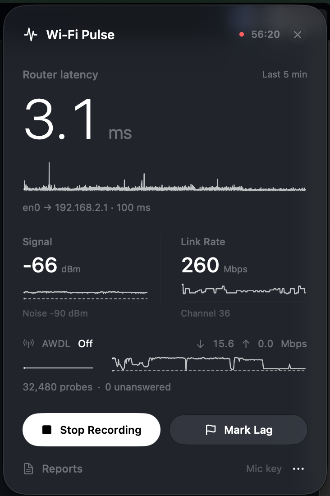

# Wi-Fi Pulse

A native macOS menu bar app for investigating Wi-Fi stutters while streaming games, making calls, or using other latency-sensitive apps. Record latency to your local router alongside Wi-Fi signal, link rate, traffic, and AWDL state, then compare them around a lag marker.


## Features

- **Lightweight recording:** router probes every 100 ms by default; Wi-Fi metrics once per second. No internet probes, speed tests, or Wi-Fi scans.
- **Live history:** five-minute graphs in a floating menu bar panel, including over fullscreen apps. Graph scrolling pauses when the panel is hidden and respects Reduce Motion.
- **Lag markers:** press the microphone key without Fn while recording, or click **Mark Lag**. The microphone key is released after recording stops; standard F5 is unchanged. Availability depends on the keyboard and macOS settings.
- **Native report library:** browse recordings in a chosen folder, newest first. New sessions appear automatically while the window is open. Interrupted sessions are marked **Incomplete**.
- **Interactive analysis:** select a time range, drag to zoom, jump to a lag marker, hover to compare measurements, and switch to logarithmic latency. Median, p95, maximum, unanswered, and late-reply statistics follow the selected range.
- **Portable reports:** every session also includes a self-contained HTML report that works offline in a browser.
- **CLI:** use the same recorder from a terminal, including automatic stop and report regeneration.



## Requirements

- **Runtime deployment target:** macOS 13 Ventura or later. Liquid Glass is used on macOS 26+; earlier versions use a material background.
- **Build:** Xcode 26 or later with the macOS 26 SDK or newer, plus Python 3 for app packaging. The source uses system frameworks only, with no external Swift package dependencies.
- **Network:** a connected Wi-Fi interface and an IPv4 router on its local subnet. No `sudo` is required.

Runtime recording and the physical microphone key have been tested on Apple Silicon with macOS 27.0.1. Compilation checks for older deployment targets do not replace runtime testing on those systems. See [compatibility notes](docs/COMPATIBILITY.md).

## Build and run

From the repository directory:

```sh
./build-app.sh
open "dist/Wi-Fi Pulse.app"
```

This builds the menu app and CLI in release mode and packages the app in `dist/`. The app is signed locally with an ad-hoc signature; it is not a notarized distribution. Quit the app before replacing its bundle with a new build. Quitting while recording saves the session first.

The build scripts explicitly use SwiftPM's native build system to preserve the deployment target declared in `Package.swift` across toolchains. Build products are ignored by Git.

To rebuild the CLI without packaging the app:

```sh
swift build --build-system native -c release
./wifi-analyzer --help
```

The launcher builds the CLI on first use if its release binary is missing. After source changes, rebuild it explicitly.

## Use the menu app



1. Click **Start Recording**, then play or use your network normally.
2. When a stutter occurs, press the microphone key or click **Mark Lag**. Account for your reaction time when inspecting the result.
3. Click **Stop Recording**, then **Reports**.
4. Choose a session in the sidebar. Use **Lag Markers** to inspect the ten seconds on either side of a marker, or select a range yourself.

Closing the panel does not stop recording. **More → Settings…** provides router and interface overrides, useful when a VPN changes the default route. Blank fields select them automatically.

The menu app initially saves sessions in:

```text
~/Library/Application Support/Wi-Fi Pulse/Sessions/
```

The folder button in **Reports** changes the shared location used for browsing and future recordings. The chosen folder persists between launches. Existing recordings are not moved automatically. The app does not install a background helper or enable launch at login.

## Command line

```sh
# Record until Ctrl+C. Enter adds a lag marker.
./wifi-analyzer record

# Stop automatically after ten minutes.
./wifi-analyzer record --duration 600

# Override router and interface, for example when using a VPN.
./wifi-analyzer record --gateway 192.168.1.1 --interface en0

# Use fewer probes and choose a new session folder.
./wifi-analyzer record --interval-ms 200 --output sessions/evening-game

# Rebuild an HTML report, including after an interrupted recording.
./wifi-analyzer report sessions/evening-game

# Generate synthetic sample data without network requests.
./wifi-analyzer demo
```

The CLI saves sessions under `sessions/` relative to the current working directory unless `--output` is set. Session folders must not already exist. `report` replaces only `report.html`. To browse CLI sessions in the native app, choose their parent folder in **Reports**.

While recording, **Enter** adds a marker, optional text before Enter labels it, and **Ctrl+C** saves the session. The microphone shortcut belongs to the menu app; the CLI uses terminal input.

Only local IPv4 router addresses on the chosen Wi-Fi subnet are accepted. DNS names, public internet addresses, and non-Wi-Fi interfaces are rejected. A default-route change ends the session to avoid mixing network paths.

## Measurements and interpretation

| Measurement | Sampling | Meaning |
| --- | --- | --- |
| Router RTT | Every 100 ms by default | System ICMP ping, best-effort traffic class |
| Replies, timeouts, late replies | Each event | Probes have unique IDs across ICMP sequence wraparound |
| RSSI, noise, link rate, channel | Once per second | CoreWLAN readings without scanning |
| AWDL state | Once per second | Administrative UP/DOWN flag, not proof of transmission |
| Download and upload | Once per second | Total traffic across all apps on the selected interface |
| Lag markers | Manual | Time of the key press or button click |

A probe is marked timed out after one second. A later reply is retained and no longer counts as unanswered. Probes still waiting at the recording cutoff remain **pending**. Missing measurements are gaps rather than zeros, and chart aggregation preserves per-pixel minima and maxima.

High router latency near a stutter suggests a problem on the local path or with the router's handling of ICMP. Normal router latency does not rule out ISP, streaming-service, routing, or video-decoding problems. This app cannot see the router's total traffic, including traffic from a phone or other device. Link rate is the negotiated Wi-Fi transmit rate, not internet throughput. Brief AWDL changes between samples may be missed. Sampling cadence depends on system scheduling and load; correlation does not establish cause.

The recorder does not change AWDL, Wi-Fi, Bluetooth, router, or Location Services settings. If you use another tool to control AWDL, leave it in your preferred state. Recording adds some load: compare the experience with and without recording under similar conditions.

## Session files and privacy

Each recording contains:

- `metadata.json`: schema version, app version, start time, OS, selected router/interface, and sampling configuration.
- `events.jsonl`: timestamped sends, replies, timeouts, measurements, markers, diagnostics, and recording boundaries.
- `ping.log`: original system ping output and its timestamps.
- `report.html`: a self-contained report containing the session data.

The native report reads `metadata.json` and `events.jsonl` directly; it does not embed a browser. HTML additionally supports Option-scroll zoom. A truncated final JSONL line is ignored with a warning; malformed complete lines are rejected.

All data remains on this Mac. The app does not collect SSIDs, BSSIDs, MAC addresses, or packet contents, and does not upload recordings. Sessions do contain local router addresses, timestamps, network metrics, and marker text. Review them before sharing. The report-library screenshot uses synthetic data; the menu-bar screenshot shows a live recording.

## Development

```sh
swift test
node --test Tests/report.test.cjs

# Optional live integration test; sends probes to the local Wi-Fi router.
python3 Tests/smoke.py .build/debug/wifi-analyzer
```

Stop menu-app recording before running the microphone hotkey test, which reserves the same physical key. To run the other tests while recording continues:

```sh
swift test --skip MicrophoneHotKeyTests
```

Node.js is needed only for HTML report tests. Python 3 is needed for packaging and the optional live test. Network and keyboard checks depend on the host environment.

The app version has one source: `Sources/WifiAnalyzerCore/Resources/VERSION`. The build script, CLI, and generated recording metadata use it. Session schema versioning is independent.

To regenerate the icon artwork and its macOS sizes:

```sh
swift Scripts/generate-app-icon.swift Assets
./build-app.sh
```

## License

[MIT](LICENSE) © 2026 shtepcell.
